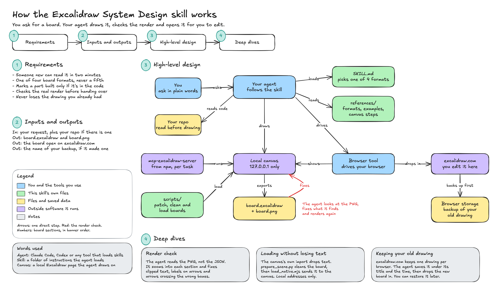
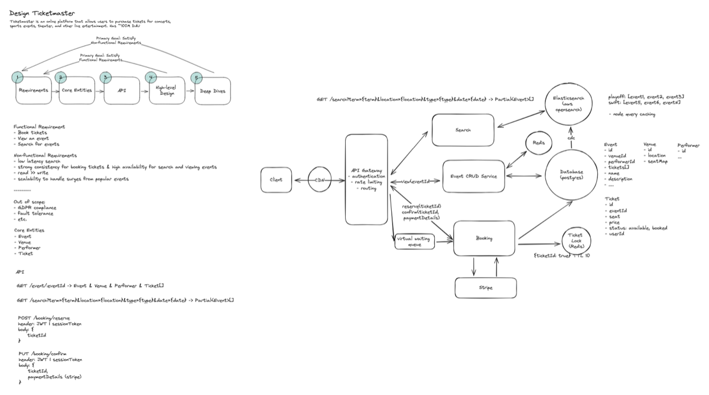
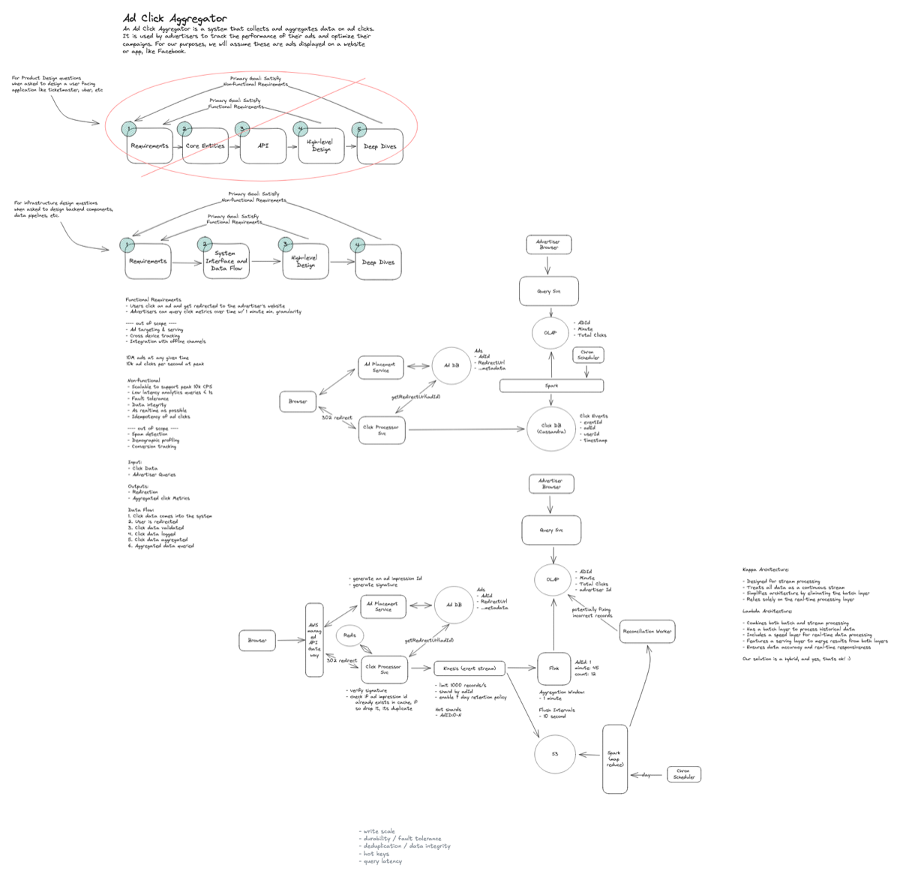
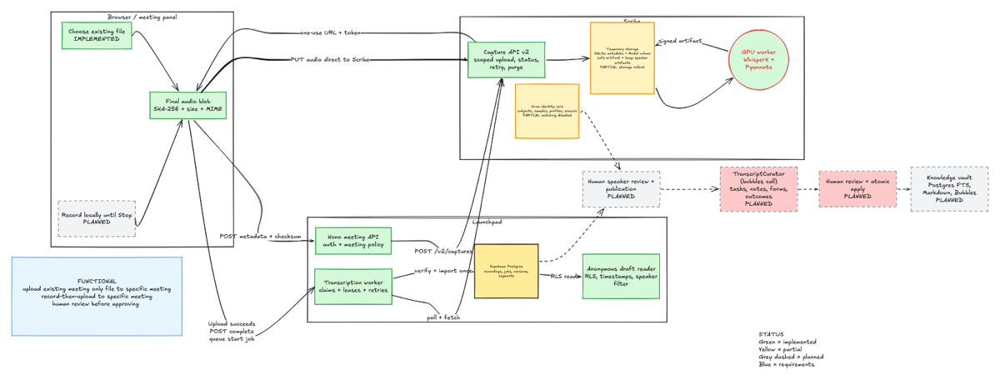

<p align="center">
  
</p>

<h1 align="center">Excalidraw System Design</h1>

<p align="center">
  <b>Describe a system. Get a whiteboard someone new to the project can read in two minutes.</b><br>
  An agent skill that picks a board format, draws it on a local Excalidraw canvas,<br>
  checks the render for clipped text and crossed arrows, then opens it on excalidraw.com for you to edit.
</p>

<p align="center">
  
  
  
  
  
  
</p>

> [!NOTE]
> The board above is this skill's own system design, drawn to its own rules. Open [`skill-design.excalidraw`](assets/readme/skill-design.excalidraw) to edit it. The skill is plain [Agent Skills](https://agentskills.io) format: a `SKILL.md`, some reference docs and three small scripts. It isn't tied to one model or agent.

## What it does

- **Picks one of four board formats** to match what you asked for: a new product, a new backend part, an existing system, or a decision between options.
- **Reads the code first** when you point it at a real codebase. It only marks a part as built if it saw it in the source.
- **Writes labels in plain words.** Each box gets a name and up to five words. Jargon goes, and any special word gets a "Words used" box.
- **Colour-codes the board** by kind (apps, services, data stores, outside services) or by status (built, partly built, planned), with a legend.
- **Checks the real render.** The agent zooms into each section of the PNG and fixes cut-off text, labels sitting on arrows and arrows crossing the wrong boxes.
- **Hands it over** as an editable `.excalidraw` file and a PNG, then opens the board on excalidraw.com in your browser. It backs up whatever drawing you had there first.

## Board formats

Each board has a numbered banner under the title, one box per section, and every section on the board carries the same number.

| Format | Use it to | Sections |
| --- | --- | --- |
| **Product** | Design a new product or app | Requirements → Core entities → API → High-level design → Deep dives |
| **Infrastructure** | Design a new backend part (queue, pipeline, rate limiter) | Requirements → Inputs and outputs → High-level design → Deep dives |
| **Existing system** | Understand or fix something already built | What it does → How it works today → What's wrong → Fixes |
| **Decision** | Choose between ways to build something | The question → What we have → Options → How the pick works → Risks → Next steps |

<table>
  <tr>
    <td width="33%"></td>
    <td width="33%"></td>
    <td width="33%"></td>
  </tr>
  <tr>
    <td align="center"><b>Product</b><br><a href="assets/examples/product.excalidraw"><code>product.excalidraw</code></a></td>
    <td align="center"><b>Infrastructure</b><br><a href="assets/examples/infrastructure.excalidraw"><code>infrastructure.excalidraw</code></a></td>
    <td align="center"><b>Existing system</b><br><a href="assets/examples/detailed.excalidraw"><code>detailed.excalidraw</code></a></td>
  </tr>
</table>

The board at the top of this page is an Infrastructure board. There's no example file for Decision boards yet; the agent builds them from the section list in [references/frameworks.md](references/frameworks.md).

## Setup

### 1. Check what you need

| You need | Why | Check |
| --- | --- | --- |
| An agent that loads Agent Skills | Runs the skill. [Claude Code](https://code.claude.com/docs/en/skills), [Codex](https://developers.openai.com/codex/skills) and [others](https://agentskills.io/clients) do | Ask it "what skills do you have?" after installing |
| A browser tool for that agent | Opens the canvas and excalidraw.com. It must run JavaScript in a page and set a file on a file input | Ask your agent to open a web page |
| Node 24 or newer | Runs the local Excalidraw canvas | `node --version` |
| Python 3 | Runs two small prep scripts | `python3 --version` |

Tested so far with Claude Code and Claude in Chrome. Nothing in the skill depends on them, but other agents and browser tools haven't been tried yet.

### 2. Install the skill

Put the skill folder where your agent looks for skills. `~/.agents/skills/` is the shared location many agents read; Claude Code reads `~/.claude/skills/`.

**From npm:**

```bash
mkdir -p ~/.agents/skills && cd ~/.agents/skills
npm pack excalidraw-system-design
tar -xzf excalidraw-system-design-*.tgz
mv package excalidraw-system-design && rm excalidraw-system-design-*.tgz
```

For Claude Code, use `~/.claude/skills` in place of `~/.agents/skills`. To update, delete the folder and run the same steps again.

**From GitHub:**

```bash
git clone https://github.com/pranavp311/excalidraw-system-design.git ~/.agents/skills/excalidraw-system-design
```

For Claude Code, clone into `~/.claude/skills/excalidraw-system-design` instead. To update, run `git pull` in that folder.

Start a new agent session so it picks up the skill.

### 3. Ask for a board

Say "excalidraw sys design" plus what you want:

```text
excalidraw sys design: a ride-matching app like the one in our pitch deck
excalidraw sys design: how the upload pipeline in this repo works today, and what's broken
excalidraw sys design: should we run our own queue or use SQS? lay out the options
```

The agent says which format it picked, draws the board, checks it, and opens it on excalidraw.com. You get the file paths, any assumptions it made, and the name of the backup if it saved one.

## How it works

1. **Pick the format.** One of the four above, never a fifth.
2. **Gather facts.** Read the code, or mark guesses as assumptions. Copy the layout of the closest example board, not its content.
3. **Start a canvas.** Installs [`mcp-excalidraw-server@2.0.0`](https://github.com/yctimlin/mcp_excalidraw) into the task's scratch folder (never globally), patches one line of it, and runs it on `127.0.0.1`.
4. **Draw.** Adds elements through the canvas CLI, or loads a cleaned `.excalidraw` file with the bundled loader.
5. **Check.** Exports the PNG, zooms into every section, fixes what's wrong and renders again.
6. **Hand over.** Exports `.excalidraw` and PNG, backs up your current excalidraw.com drawing in that browser's local storage, drops the board onto the page, and stops the canvas server.

Nothing is uploaded to a server. The board goes from disk into the excalidraw.com page through a file input, and edits you make there stay in that browser until you export them.

## What runs on your machine

Nothing runs until you ask for a board. Then:

| What | Where | What it does |
| --- | --- | --- |
| `mcp-excalidraw-server@2.0.0` | npm, installed per task into a scratch folder | The local canvas and its CLI |
| [`scripts/patch_canvas_2_0_0.py`](scripts/patch_canvas_2_0_0.py) | This folder | Patches one line of the canvas frontend so the loader works |
| [`scripts/prepare_scene.py`](scripts/prepare_scene.py) | This folder | Writes a clean copy of a board: drops deleted elements, broken links and bad order keys. Never overwrites the original |
| [`scripts/load_native.mjs`](scripts/load_native.mjs) | This folder | Loads a cleaned board onto a local canvas without losing text. Refuses anything but `localhost` |

## Files

```text
excalidraw-system-design/
├── README.md                   # this page
├── SKILL.md                    # the instructions the agent follows
├── references/
│   ├── frameworks.md           # what goes in each section of each format
│   ├── examples.md             # which example to copy for which format
│   └── canvas.md               # canvas setup, loading, export, opening on excalidraw.com
├── scripts/                    # the three helpers above
└── assets/
    ├── examples/               # example boards the agent copies layouts from
    └── readme/                 # images for this page, plus this skill's own board
```

## Troubleshooting

| Problem | Fix |
| --- | --- |
| Canvas server exits with code 1 | The port is taken. Ask the agent to use another one. |
| Board looks empty after loading | An open tab wrote its old drawing back. The agent checks the element count and loads into a fresh canvas on another port. |
| You lost the drawing you had on excalidraw.com | Ask the agent to restore your excalidraw.com backup. Backups are named after the drawing's title plus a timestamp. The steps are in [canvas.md](references/canvas.md). |
| The board has an embedded image | The loader can't carry images. Open that board on excalidraw.com yourself with **Open**. |

## References

- [SKILL.md](SKILL.md): the full instructions: formats, wording rules, colour rules, render checks, hand-over.
- [references/frameworks.md](references/frameworks.md): section-by-section contents for Product, Infrastructure, Existing system and Decision boards.
- [references/examples.md](references/examples.md): what to copy from each example board.
- [references/canvas.md](references/canvas.md): starting the canvas, loading and exporting scenes, opening the board on excalidraw.com, restoring a backup, and approaches that were tried and dropped.
- [Agent Skills](https://agentskills.io): the open skill format this follows, and the agents that support it.
- [Excalidraw](https://github.com/excalidraw/excalidraw): the editor and its `.excalidraw` file format.
- [yctimlin/mcp_excalidraw](https://github.com/yctimlin/mcp_excalidraw): the local canvas server and CLI this skill runs.

## License

[MIT](LICENSE)
